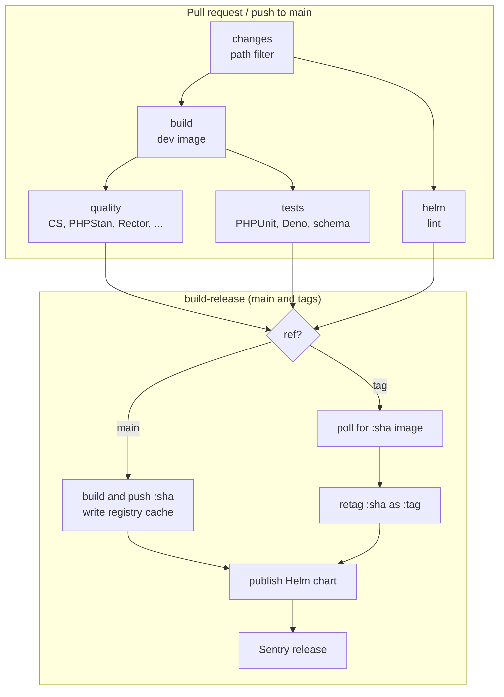

# CI/CD

Everything lives in `.github/workflows/ci.yml` (Dependabot and other workflows aside). One workflow, three kinds of
runs, chosen by the trigger.

| Trigger                 | Jobs that run                                                                 | Publishes                         |
|-------------------------|-------------------------------------------------------------------------------|-----------------------------------|
| Pull request            | `changes`, `build`, `helm`, `quality`, `tests` (heavy ones can be skipped)     | Nothing                           |
| Push to `main`          | Same as a PR, with no skipping, then `build-release`                          | `:<sha>` image, Helm chart, Sentry release (`acceptance`) |
| Tag (`v1.2.3`)          | Only `build-release`                                                          | `:<tag>` image (retag), Helm chart, Sentry release (`production`) |

`workflow_dispatch` runs behave like a branch run on the chosen ref.

The `tests` job runs PHPUnit through ParaTest with one process per core (ParaTest and `bin/reload-test-dbs` both default to the core count), each on its own database
created by `bin/reload-test-dbs`. JUnit and Cobertura reports are merged by ParaTest.

On a tag run `changes`, `build`, `helm`, `quality` and `tests` are skipped (their `if:` excludes tags). `build-release`
still starts because its condition uses `always() && !failure()`, and a skipped dependency is not a failure. The `needs`
list therefore only gates `main`.

## Pull requests

- `changes` lists the PR's files. If **every** file is on the skip list (docs, `.idea`, `dependabot.yml`, workflows
  other than `ci.yml`), `build`, `quality` and `tests` are skipped. `helm` is skipped unless `helm/` or `ci.yml`
  changed. It fails closed: any detection error, or any file not on the list, runs everything.
- Skipping uses job-level `if:`, never workflow-level `paths:`. The ruleset requires the `Tests` and `Code Quality`
  checks, which must still report (a skipped job counts as passing). **Do not rename those two jobs** without updating
  the ruleset.
- A new push cancels the PR's older run.
- PR jobs only read caches, they never write to the registry (fork and Dependabot tokens cannot push to GHCR).

## Push to main

- Runs everything, no skipping.
- `build-release` builds the production image and pushes it as `ghcr.io/<repo>:<short-sha>`, publishes the chart as
  `0.0.0-main.<run_number>` with that sha as app version, and creates the Sentry release `acceptance`.
- Runs are never cancelled mid-run, because `build-release` publishes. GitHub keeps one queued run per group, so a
  burst of merges runs the first and the latest commit.

## Tags (releases)

A release is the commit main already built, so nothing is rebuilt:

1. Push the commit to main and wait for CI to pass.
2. Tag it. `build-release` polls (up to 20 minutes) for the `:<sha>` image. It only exists once main's
   `build-release` passed, so this doubles as the "CI passed on this commit" gate.
3. `docker buildx imagetools create` retags `:<sha>` as `:<tag>`. Then the chart is published with the tag as version
   and the Sentry release `production` is created.

If the tag run fails with "not found after 20 minutes", the commit never finished on main. Fix that, then re-run.

### Why `GIT_TAG` is not in the image

Production versus acceptance is decided by `GIT_TAG` (`BuildEnvironmentExtension`): set means production, unset with a
`GIT_SHA` means acceptance. Since one image serves both, the Helm chart sets `GIT_TAG` at runtime, only when the image
tag looks like a version (`x.y.z`, optional `v`). `GIT_SHA`, `GIT_COMMIT_TIME` and `BUILD_TIME` are still baked in at
build time (same commit, so identical for both tags).

## Caching

- The Dockerfile's `frankenphp_base` stage (PHP extensions) is shared by the dev and prod targets.
- `build-release` on main writes a registry cache to `ghcr.io/tijdvoordetest/tijdvoordetest:buildcache`
  (`mode=max`, so it includes the base stage). Every build reads it. Keep the package public, or PR jobs cannot pull it.
- `build`, `quality` and `tests` also share a per-ref GitHub Actions cache (`<ref>-devbuild`) so the dev image is built
  once per run.

## Dependencies

Dependabot (`.github/dependabot.yml`) covers Composer, Docker and GitHub Actions. The FrankenPHP base image is pinned as
`<version>-php<minor>@sha256:...` because Dependabot cannot parse a tag like `1.13-php8.5.12`. It bumps the digest
(PHP patch releases) and the FrankenPHP minor, but never the PHP minor. That is a manual change.
